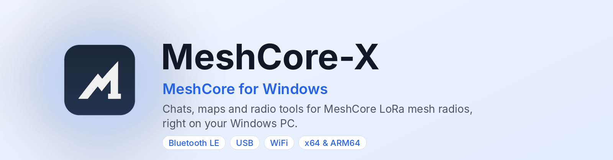
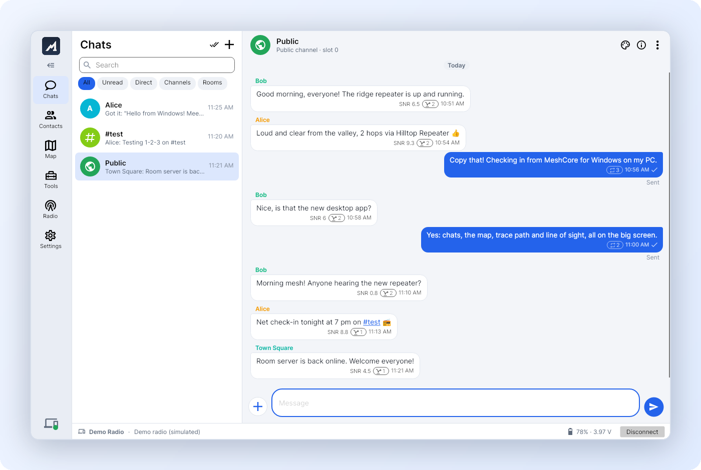
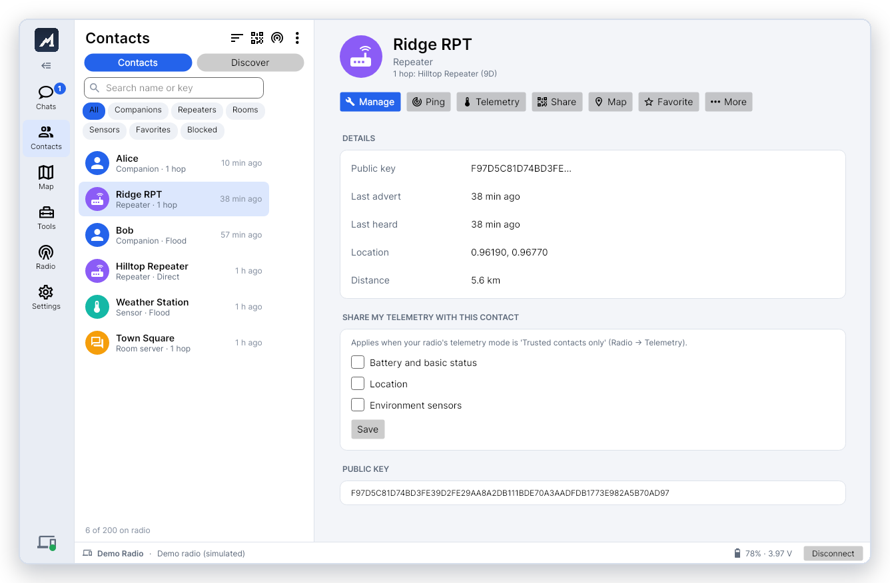
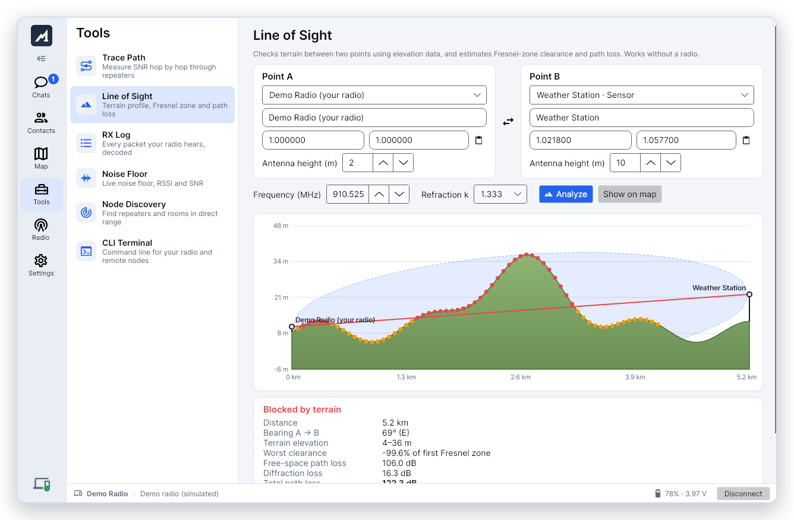
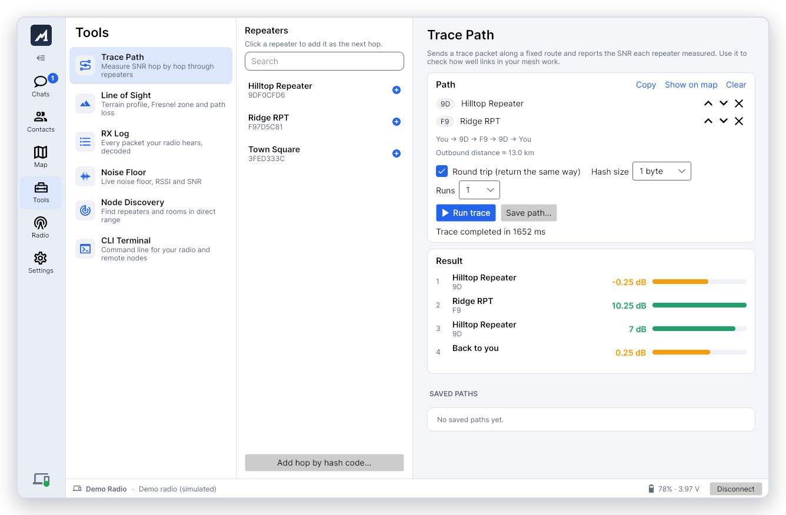
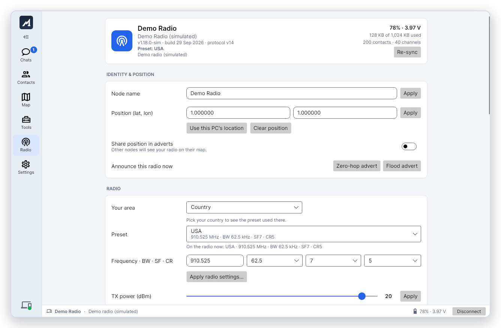
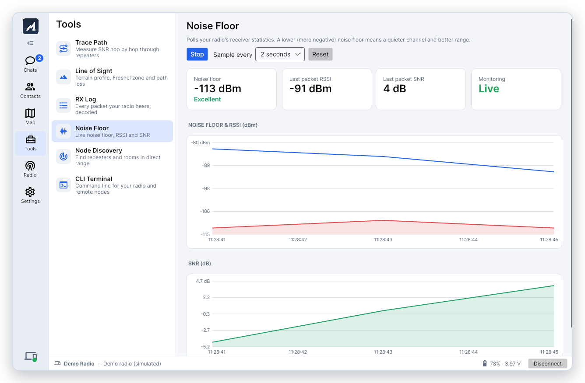
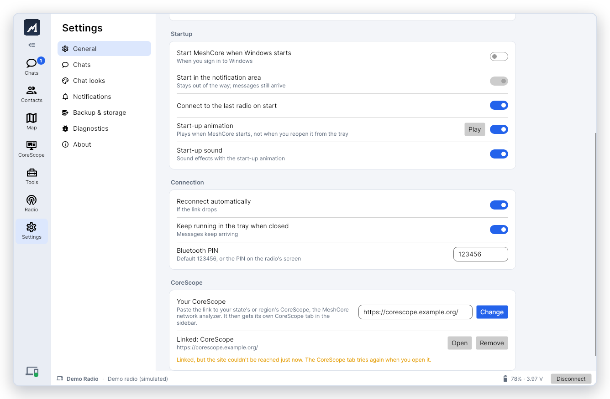

<p align="center">
  <picture>
    <source media="(prefers-color-scheme: dark)" srcset="docs/images/banner-dark.png">
    
  </picture>
</p>

<p align="center">
  <a href="https://github.com/Yandi9/Meshcore-X/releases"></a>
  <a href="https://github.com/Yandi9/Meshcore-X/releases"></a>
  
  
  <a href="LICENSE"></a>
</p>

<p align="center">
  <a href="https://github.com/Yandi9/Meshcore-X/releases/download/v1.2.0/MeshCore-1.2.0-win-x64.zip"></a>
  &nbsp;
  <a href="https://github.com/Yandi9/Meshcore-X/releases/download/v1.2.0/MeshCore-1.2.0-win-arm64.zip"></a>
</p>

**MeshCore-X** is a Windows desktop app for [MeshCore](https://meshcore.io) LoRa mesh radios. Connect your companion radio over Bluetooth LE, USB or WiFi, then chat with the mesh, see it on a map and use full radio tools on a big screen with a keyboard and mouse.

It's the Windows adaptation of [MeshCore One](https://github.com/Avi0n/MeshCoreOne) by Avi0n and contributors, maintained by **YndreW**. Version 1.2.0 matches MeshCore One 1.7.1.

<p align="center">
  <picture>
    <source media="(prefers-color-scheme: dark)" srcset="docs/images/hero-dark.png">
    
  </picture>
</p>

## Features

- **Chats**: direct messages, channels and room servers. Pin chats, mark them read or unread, reply, react, and share pictures and links. Every message shows its signal (SNR), hops and how many repeaters passed it on.
- **Blocks & filters**: hide messages that match a word or phrase in the message or the sender's name, choose which chats the rules apply to, and see what was hidden under *Recently blocked*.
- **Emergency messages**: MECP (Mesh Emergency Communication Protocol) messages read as plain phrases in your language.
- **Contacts**: companions, repeaters, rooms and sensors. Sort them by last advert, name, distance or hops, share them by QR code, and choose who sees your telemetry.
- **Map**: every node with a position, on standard, dark, satellite or topographic maps. Filter by when nodes were last heard and how many hops away they are, draw paths, and save maps for offline use.
- **Radio tools**: trace path, line of sight with a terrain profile and Fresnel zone, RX log, noise floor, node discovery and a command-line terminal.
- **Repeater, room and sensor admin**: sign in to remote nodes for their status, history charts, neighbours, settings and console, and change a sensor's settings.
- **Radio settings**: presets for your country and state, frequency, power, position, adverts and your radio's own telemetry. On firmware 1.18 you also get radio WiFi settings, power off, and switching between Bluetooth and WiFi.
- **CoreScope tab**: link your state's or region's [CoreScope](https://github.com/Kpa-clawbot/CoreScope) network analyzer and browse it inside the app.
- **Backups**: MeshCore One `.mc1backup` files. Restoring a backup from the iPhone app brings back your contacts, channels, messages and the radio's preset and frequency.
- **Made for Windows**: notifications, a tray icon, start with Windows, an optional lock screen widget, light and dark themes, and 8 languages.
- **Demo radio**: try every feature without hardware.

## Screenshots

<table>
  <tr>
    <td width="50%" align="center">
      <picture>
        <source media="(prefers-color-scheme: dark)" srcset="docs/images/contacts-dark.png">
        
      </picture>
      <br><sub><b>Contacts</b>: details, telemetry sharing and quick actions</sub>
    </td>
    <td width="50%" align="center">
      <picture>
        <source media="(prefers-color-scheme: dark)" srcset="docs/images/line-of-sight-dark.png">
        
      </picture>
      <br><sub><b>Line of sight</b>: terrain profile, Fresnel zone and path loss</sub>
    </td>
  </tr>
  <tr>
    <td width="50%" align="center">
      <picture>
        <source media="(prefers-color-scheme: dark)" srcset="docs/images/trace-path-dark.png">
        
      </picture>
      <br><sub><b>Trace path</b>: SNR for every hop through your repeaters</sub>
    </td>
    <td width="50%" align="center">
      <picture>
        <source media="(prefers-color-scheme: dark)" srcset="docs/images/radio-dark.png">
        
      </picture>
      <br><sub><b>Radio</b>: presets for your area, power, position and adverts</sub>
    </td>
  </tr>
  <tr>
    <td width="50%" align="center">
      <picture>
        <source media="(prefers-color-scheme: dark)" srcset="docs/images/noise-floor-dark.png">
        
      </picture>
      <br><sub><b>Noise floor</b>: live noise, RSSI and SNR charts</sub>
    </td>
    <td width="50%" align="center">
      <picture>
        <source media="(prefers-color-scheme: dark)" srcset="docs/images/corescope-dark.png">
        
      </picture>
      <br><sub><b>CoreScope</b>: paste your region's link to get its own tab</sub>
    </td>
  </tr>
</table>

<sub>Screenshots use the built-in demo radio; all names are fictional. Images follow your GitHub light or dark theme.</sub>


## Download and install

| Your PC | Download |
|---|---|
| Intel or AMD (most Windows PCs) | [MeshCore-1.2.0-win-x64.zip](https://github.com/Yandi9/Meshcore-X/releases/download/v1.2.0/MeshCore-1.2.0-win-x64.zip) |
| Windows on ARM (Surface Pro with Snapdragon, Copilot+ PCs) | [MeshCore-1.2.0-win-arm64.zip](https://github.com/Yandi9/Meshcore-X/releases/download/v1.2.0/MeshCore-1.2.0-win-arm64.zip) |

1. Download the ZIP for your PC from the [releases page](https://github.com/Yandi9/Meshcore-X/releases).
2. Extract the whole ZIP to a folder.
3. Run `MeshCore-x64.exe` or `MeshCore-arm64.exe`. You don't need to install .NET or anything else.

The app isn't code-signed yet. If Windows SmartScreen appears, click **More info**, then **Run anyway**. You can check your download against `SHA256SUMS.txt` on the release page.

**To update**, close MeshCore from its tray icon, extract the new ZIP and run the new executable. Your chats, contacts and settings are kept in `%APPDATA%\MeshCore`.

**Requirements**

- Windows 10 version 2004 or newer, or Windows 11.
- A MeshCore companion radio, connected over Bluetooth LE, USB or WiFi. Without one, you can still use the demo radio.
- For the optional lock screen widget, Windows 11. Keep the `LockScreenWidget` folder next to the executable and install it from **Settings ▸ Notifications ▸ Lock screen**.

See the [Windows guide](docs/WINDOWS-GUIDE.md) for connecting a radio and using every feature, and the [changelog](CHANGELOG.md) for what's new.

## Link your state's CoreScope

Many states and regions run a CoreScope, a web analyzer for their mesh with live packets, a map, nodes, channels and analytics.

1. In MeshCore-X, open **Settings ▸ General ▸ CoreScope**.
2. Paste the link and click **Link**.

A **CoreScope** tab appears in the sidebar and shows the site inside the app.

## Build from source

Install the [.NET 10 SDK](https://dotnet.microsoft.com/download), then run these from the repository root:

```powershell
dotnet test tests/MeshCore.Tests -c Release
dotnet test tests/MC1.Core.Tests -c Release
./publish.ps1
```

`publish.ps1` builds both Windows versions (x64 and ARM64) into `dist`.

The lock screen widget is packaged separately with `packaging/widget/build.sh`, in WSL or Linux with .NET 10, Python 3, openssl, osslsigncode, curl and unzip. Keep the signing key outside the repository, and keep the widget package version at 1.2.0.0 so updates install over it.

Build and test results for each version are in [docs/VALIDATION.md](docs/VALIDATION.md).

## Feedback

Found a bug or have an idea? [Open an issue](https://github.com/Yandi9/Meshcore-X/issues). Test results from real radios, especially firmware 1.18, are very welcome.

## Credits and license

MeshCore-X is based on **[MeshCore One](https://github.com/Avi0n/MeshCoreOne) by Avi0n and contributors** and, like it, is licensed under [GPL-3.0](LICENSE). The Swift MeshCore protocol library is credited for the protocol work, and its MIT notice is kept in [licenses](licenses). No Swift source, Xcode project, iPhone app or Apple widget code is included.

Thanks to [MeshCore and its contributors](https://github.com/meshcore-dev/MeshCore), [meshcore_py](https://github.com/meshcore-dev/meshcore_py), [Avalonia](https://avaloniaui.net), and the other projects listed in [THIRD-PARTY-NOTICES.md](THIRD-PARTY-NOTICES.md).

MeshCore-X is an independent desktop adaptation. It isn't affiliated with or endorsed by the MeshCore or MeshCore One projects.
